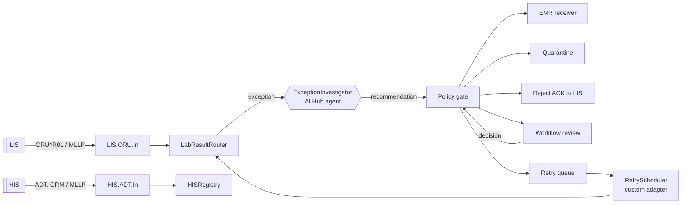

<p align="center"></p>

# CareBridge AI

**Intelligent hospital interoperability and exception management.**
Connecting hospital systems. Investigating exceptions. Governing AI decisions.

> Every message is traceable. Every AI recommendation is reviewable. Every executed action is controlled.

CareBridge AI is an InterSystems IRIS for Health interoperability production for the **InterSystems Programming Contest: AI Agents in Interoperability Workflows**. A laboratory system sends HL7 v2 results. IRIS validates each one, and when a result can't be routed safely, an **IRIS AI Hub agent** investigates the exception with read-only tools and recommends what to do. A **deterministic policy gate** decides whether that recommendation may run. The production then delivers the result, quarantines it, rejects it back to the lab, schedules a retry, or hands it to a person through the **Workflow Engine**. All data is synthetic.

Built and tested on **AI Hub Early Access Community build 2027.1.0AI.109.0 (IRIS for Health), ARM64 and x64.**

---

## What problem it solves

A lab result can be valid HL7 and still be unsafe to route. Common examples:

- the patient isn't registered yet
- the order number doesn't exist
- the order belongs to a different patient
- the lab resent the same result
- a required field is empty
- the clinical record system is temporarily down

Interface teams handle these exceptions by hand. Most of the work is routine investigation: look up the patient, look up the order, check the message history, then decide whether to hold it, send it back, suppress it, retry it or escalate it. Some cases, such as an ambiguous patient identity, must always reach a person.

## Why it needs IRIS interoperability

The decision sits in the middle of a real message flow:

- MLLP listeners for the HIS and LIS, with HL7 ACKs
- a business process that keeps state across an asynchronous human decision
- operations with retries and queues
- the Workflow Engine for human tasks
- a Visual Trace of every hop

CareBridge uses all of these as they are. The agent is one business operation in the production, not the application around it.

## What the AI Hub agent decides

`CareBridge.ExceptionInvestigator` (a `%AI.Agent`) gets a sanitised case: identifiers, codes, findings and the permitted actions. It has six read-only tools: `LookupPatient`, `LookupOrder`, `OrdersForPatient`, `MessageHistory`, `DuplicateStatus` and `ValidationFindings`. It returns a JSON recommendation:

```json
{"exception_type":"UNKNOWN_ORDER","recommended_action":"MANUAL_REVIEW",
 "reason":"Patient exists but the order is not in the HIS registry.",
 "evidence":["PATIENT_FOUND","ORDER_NOT_FOUND"],"requires_human_review":true}
```

The choices are real: suppress a duplicate, reject a result missing its patient id back to the lab, retry a failed delivery within the retry budget, or quarantine or escalate an unknown order. The agent is **never** allowed to accept a result that has an open exception. Only a person can do that, and only through the policy gate.

## How the policy gate governs execution

`CareBridge.Engine.PolicyGate` checks every recommendation, from the agent or a human reviewer, against rules, and records the result of each rule:

| Rule | Prevents |
|---|---|
| Contract and enum validation | Free text, unknown actions (`merge_patient_records`), extra fields (`patient_update`) |
| Evidence must be observed | Invented or injected evidence (`PRE_APPROVED`) |
| Action permitted for this exception type | The agent accepting results; anything off the matrix |
| Identity conflict needs a human | Automatic routing when patient and order disagree |
| Retry budget | Endless retries |
| No duplicate delivery (plus a unique index in the receiver) | Delivering the same result twice |
| Human decisions need a note, a known reviewer, and a re-check of current state | A reviewer accepting a result for a patient who still isn't registered |

Invalid output, a timeout or a provider error never leads to an automatic action. The fallback is manual review.



See [docs/architecture.md](docs/architecture.md) for the components and a sequence diagram.

---

## Install

You need Docker and the AI Hub image from the InterSystems Early Access portal. The image is not on any public registry, and this project never pushes it.

```bash
git clone https://github.com/shaileshvats/carebridge-ai && cd carebridge-ai
# 1. Download irishealth_arm64-community-2027.1.0AI.109.0-docker.tar.gz (Apple Silicon/ARM64)
#    or irishealth-community-2027.1.0AI.109.0-docker.tar.gz (x86-64) from
#    https://evaluation.intersystems.com/Eval/early-access/AIHub , then:
scripts/load-image.sh ~/Downloads/irishealth_arm64-community-2027.1.0AI.109.0-docker.tar.gz
# 2. Start (REPLAY mode by default: no API key needed)
docker compose up -d --build
scripts/wait-ready.sh
```

Open the dashboard at **<http://localhost:52773/carebridge/index.html>**. The Management Portal is at <http://localhost:52773/csp/sys/UtilHome.csp> and shows the production, Visual Trace and Workflow.

The full steps (manual load and retag, IPM install, reset) are in [docs/installation.md](docs/installation.md).

**IPM:** `zpm "install carebridge-ai"` in an interoperability-enabled namespace on AI Hub 2026.3 or later. The manifest declares `<SystemRequirements Version="&gt;=2026.3" Interoperability="enabled"/>`.

## Run the demo

- **Dashboard → Demo scenarios → Run all scenarios.** Eleven scenarios send synthetic HL7 over MLLP to the running production. Seven cover the core workflow; four are adversarial or failure tests.
- Or from a terminal: `scripts/demo.sh`
- Then open **Message explorer** and select any message to follow it end to end: original HL7, validation findings, the agent's tool calls, input and raw output, every policy rule, the audit timeline and the final execution.
- **Manual review** lists Workflow tasks. Try *unknown-patient*:
  1. ACCEPT is refused, because the patient isn't registered.
  2. Click *Register the patient from the HIS*, which sends an ADT^A04.
  3. ACCEPT is now allowed, and the result is delivered.

The scenarios are described in [docs/demo-scenarios.md](docs/demo-scenarios.md).

## Run the tests

```bash
scripts/run-tests.sh        # 37 unit tests
scripts/run-tests.sh --all  # + 8 integration tests through the live production (resets demo data)
```

See [docs/testing.md](docs/testing.md) for what each suite covers and the latest report.

## Configure live AI

REPLAY mode runs the real production, real tools, real contract validator and real policy gate. Only the model's reply is a recorded fixture, and the dashboard shows which mode is active. For LIVE mode, copy `.env.example` to `.env` and choose a provider:

```bash
CAREBRIDGE_AGENT_MODE=LIVE
CAREBRIDGE_LLM_PROVIDER=openai          # or anthropic, gemini, ... (any AI Hub provider)
CAREBRIDGE_LLM_MODEL=gpt-4.1-mini
OPENAI_API_KEY=...                       # never committed; .env is git-ignored
```

A local OpenAI-compatible server works too, with no key and no cost:

```bash
CAREBRIDGE_LLM_BASE_URL=http://host.docker.internal:1234/v1   # LM Studio (Ollama: :11434/v1)
CAREBRIDGE_LLM_MODEL=qwen/qwen3-4b-2507
```

Then run `docker compose up -d`. [docs/ai-agent.md](docs/ai-agent.md) lists what data is sent to the provider (no names, no result values, no free text) and all the options.

## Online demo

There is no public online demo yet. The local Docker setup above is the reference environment.

## Inspect the code

| Where | What |
|---|---|
| [`src/CareBridge/Production.cls`](src/CareBridge/Production.cls) | The production |
| [`src/CareBridge/Process/LabResultRouter.cls`](src/CareBridge/Process/LabResultRouter.cls) | Orchestration, execution, Workflow round trip |
| [`src/CareBridge/ExceptionInvestigator.cls`](src/CareBridge/ExceptionInvestigator.cls) | The AI Hub agent |
| [`src/CareBridge/AI/`](src/CareBridge/AI/) | Tools, toolset, audit and authorization policies, live runner |
| [`src/CareBridge/Engine/PolicyGate.cls`](src/CareBridge/Engine/PolicyGate.cls) | The policy gate |
| [`src/CareBridge/Engine/ReplayAgent.cls`](src/CareBridge/Engine/ReplayAgent.cls) | Replay adapter and adversarial fixtures |
| [`src/CareBridge/Adapter/DueWorkInboundAdapter.cls`](src/CareBridge/Adapter/DueWorkInboundAdapter.cls) | Custom inbound adapter for retries |
| [`src/CareBridge/Test/`](src/CareBridge/Test/) | Unit and integration tests |
| [`web/`](web/) | Dashboard (plain HTML/JS served by IRIS) |

More documentation:

- [Security and privacy](docs/security.md)
- [Observability and tracing](docs/observability.md)
- [Design decisions](DECISIONS.md)
- [Contest compliance](docs/contest-compliance.md)

## Limitations

- All data is synthetic, and the HIS, LIS and EMR are simulations inside the same container. CareBridge has not been used in a hospital and makes no regulatory claim.
- Only one workflow is covered: ORU^R01 lab results with six exception types.
- The dashboard and API are unauthenticated demo applications, bound to localhost by Compose. Reviewer identities are synthetic.
- REPLAY fixtures are recorded replies; the adversarial ones deliberately imitate a misbehaving model to test the gate.
- AI Hub is pre-release software, and APIs may change between builds.

## Licence

To be confirmed by the owner before the repository is made public (proposed: Apache-2.0).
