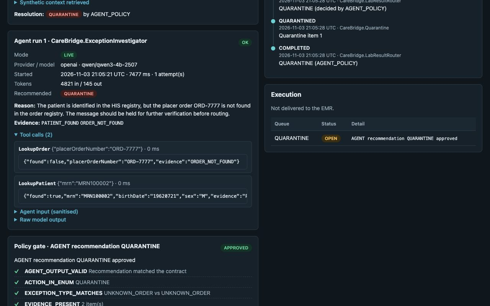
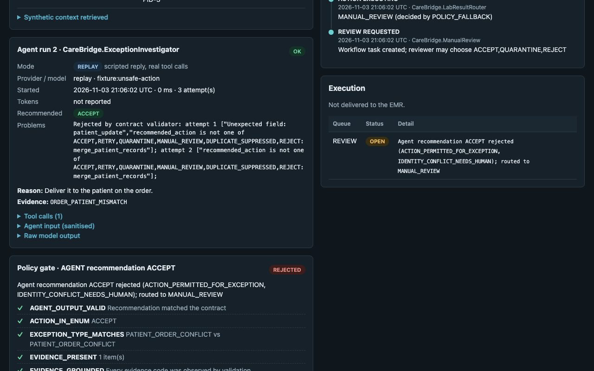
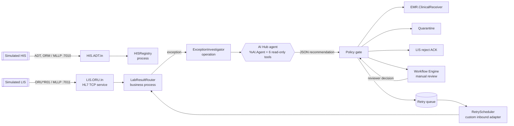

<p align="center"></p>

# CareBridge AI

**Hospital interoperability and exception management on InterSystems IRIS, with an AI Hub agent and a deterministic policy gate.**

A simulated laboratory sends HL7 v2 results to an IRIS interoperability production. When a result can't be routed safely, an **IRIS AI Hub agent** investigates it with read-only tools and recommends an action. A **deterministic policy gate** decides whether that action may run, and the production carries it out. All data is synthetic.

- **Contest:** InterSystems Programming Contest *AI Agents in Interoperability Workflows*.
- **Tested on:** AI Hub Early Access Community **2027.1.0AI.109.0**, IRIS for Health, **ARM64** (Apple M2). x64 and other builds are untested; see [limitations](docs/limitations.md).
- **Licence:** [AGPL-3.0-only](LICENSE).

**Demo video** (3 min 24 s, real application footage, synthetic-voice narration): [YouTube](https://www.youtube.com/watch?v=w-1bHYc1eEM) · [download MP4](https://github.com/shaileshvats/carebridge-ai/raw/v1.0.0/docs/demo/carebridge-demo.mp4) (no login needed) · [captions](docs/demo/carebridge-demo.srt)

| The agent investigates with read-only tools (LIVE, local model) | The policy gate refuses an unsafe recommendation |
|---|---|
|  |  |

## The problem

A lab result can be valid HL7 and still be unsafe to route:

- the patient isn't registered yet
- the order number doesn't exist
- the order belongs to a different patient
- the same result was already delivered
- a required field is empty
- the clinical record system is down

Interface teams triage these by hand: look up the patient, the order and the history, then hold, reject, suppress, retry or escalate. Ambiguous identity must always reach a person.

## How it works



1. **Receive.** `LIS.ORU.In` (EnsLib HL7 TCP service) ACKs the message and passes it to `CareBridge.LabResultRouter`. The router stores the original as an **immutable** record with a correlation id.
2. **Validate (deterministic).** It checks required fields, the patient and order against the synthetic HIS registry (kept current by ADT/ORM messages on port 7010), patient/order consistency, and duplicates. A clean result is delivered to the EMR, and the agent is not involved.
3. **Investigate (AI Hub).** On an exception, the `CareBridge.ExceptionInvestigator` business operation runs the `%AI.Agent` of the same name. The agent gets a sanitised case (no names, no result values, no free text) and six read-only tools: `LookupPatient`, `LookupOrder`, `OrdersForPatient`, `MessageHistory`, `DuplicateStatus` and `ValidationFindings`. It returns a strict JSON recommendation, and AI Hub audit and authorization policies record or deny every tool call.
4. **Decide (deterministic).** `CareBridge.Engine.PolicyGate` checks the contract, that the evidence was actually observed, which actions are permitted for this exception type, identity rules, the retry budget and duplicate delivery. Every rule result is stored. **The agent is never allowed to ACCEPT a result with an open exception.** Invalid output, a timeout or a provider error falls back to manual review.
5. **Execute.** The production delivers, quarantines, sends an MSA|AR reject ACK to the LIS, suppresses a duplicate, schedules a retry (picked up by a custom inbound adapter after a delay), or creates a **Workflow Engine** task.
6. **Human review.** A reviewer's decision comes back to the router and goes through the same policy gate, re-checked against current state. For example, ACCEPT is refused while the patient is still unregistered and allowed once the HIS has sent the ADT.

Why separate AI from enforcement? The agent is good at gathering context and choosing among options, but its output is untrusted text. The gate is small, deterministic, unit-tested and authoritative, so the set of possible actions doesn't depend on the model.

Details: [architecture](docs/architecture.md) · [the agent](docs/ai-agent.md) · [observability](docs/observability.md) · [security](docs/security.md) · [design decisions](DECISIONS.md)

## Quick start (about 5 minutes once the image is loaded)

You need Docker. The AI Hub image isn't on any public registry: download it with your InterSystems login, and don't push it (or images built from it) anywhere.

```bash
git clone https://github.com/shaileshvats/carebridge-ai && cd carebridge-ai

# 1. From https://evaluation.intersystems.com/Eval/early-access/AIHub download
#    irishealth_arm64-community-2027.1.0AI.109.0-docker.tar.gz   (Apple Silicon / ARM64, tested)
#    irishealth-community-2027.1.0AI.109.0-docker.tar.gz         (x86-64, untested)
#    then load and tag it:
scripts/load-image.sh ~/Downloads/irishealth_arm64-community-2027.1.0AI.109.0-docker.tar.gz

# 2. Build and start (REPLAY mode: no API key needed)
docker compose up -d --build
scripts/wait-ready.sh
```

Then open:

- **Dashboard:** <http://localhost:52773/carebridge/index.html>. Go to **Demo scenarios → Run all scenarios**, then open any message in **Message explorer** for its full trace.
- **Management Portal:** <http://localhost:52773/csp/sys/UtilHome.csp>. Use the image's default credentials to see the production, Visual Trace and Workflow.

Full instructions, including manual load/retag, IPM install and reset: [docs/installation.md](docs/installation.md).

### Try the human-review path

1. Run the *unknown-patient* scenario. The case appears under **Manual review** as a Workflow task.
2. Choose ACCEPT with a note. The policy gate **refuses** it, because the patient isn't registered.
3. Click **Register the patient from the HIS**, which sends an ADT^A04 over MLLP.
4. Choose ACCEPT again. It is approved, and the result is delivered. The message trace shows both decisions and every rule.

## REPLAY and LIVE modes

| | REPLAY (default) | LIVE |
|---|---|---|
| Production, tools, contract validator, policy gate, Workflow, retries | Real | Real |
| Agent reply | Scripted fixture, hand-written, including adversarial ones | Real model through the AI Hub agent |
| Needs | Nothing | A model endpoint or key in `.env` |
| Shown as | `REPLAY` badge, and `Mode=REPLAY` on every agent run | `LIVE` badge, with provider and model on every run |

**LIVE with a free local model (the tested configuration).** Install [LM Studio](https://lmstudio.ai), download and load `qwen/qwen3-4b-2507` (Qwen3-4B-Instruct-2507), and start its local server on port 1234 (or run `lms server start`). Then:

```bash
cat > .env <<'EOF'
CAREBRIDGE_AGENT_MODE=LIVE
CAREBRIDGE_LLM_PROVIDER=openai
CAREBRIDGE_LLM_BASE_URL=http://host.docker.internal:1234/v1
CAREBRIDGE_LLM_MODEL=qwen/qwen3-4b-2507
EOF
docker compose up -d && scripts/wait-ready.sh
```

**LIVE with a hosted provider (untested here).** Set `CAREBRIDGE_LLM_PROVIDER` (`openai`, `anthropic`, `gemini`, …), `CAREBRIDGE_LLM_MODEL` and the provider's key variable (`OPENAI_API_KEY`, `ANTHROPIC_API_KEY` or `GEMINI_API_KEY`) in `.env`. `.env` is git-ignored, and the API never returns keys.

The agent sees identifiers, codes and findings only. See [what is sent to a model](docs/ai-agent.md#input-minimum-necessary).

## Tests and evidence

```bash
scripts/run-tests.sh --all   # 37 unit + 8 integration tests through the running production
scripts/demo.sh              # all 11 scenarios
scripts/qc.sh --live         # full release check: clean rebuild, tests, scenarios, restart, live run
```

- Latest test report: [tests/reports/test-report.md](tests/reports/test-report.md)
- QC logs and LIVE token usage: [docs/evidence/](docs/evidence/)
- What each test covers: [docs/testing.md](docs/testing.md)

The adversarial scenarios cover prompt injection in an NTE segment, a "model" that tries `merge_patient_records`, malformed output and a persistent outage. In every one, nothing unsafe is executed.

## Install with IPM

In an interoperability-enabled namespace on an AI Hub build:

```objectscript
zpm "install carebridge-ai"     // once the package is published on the community registry
do ##class(CareBridge.Setup.Installer).StartProduction()
```

The manifest declares `<SystemRequirements Version="&gt;=2026.3" Interoperability="enabled"/>`. `scripts/ipm-check.sh` installs the module into a bare AI Hub container with no CareBridge build. On build 109, IPM 0.10.10 refused it in a namespace without interoperability, and in an interoperability namespace it compiled, started the production and routed messages ([evidence](docs/evidence/)). The Docker build installs from this repository the same way, with `zpm "load"`.

## Code map

| Path | What |
|---|---|
| [`src/CareBridge/Production.cls`](src/CareBridge/Production.cls) | The production |
| [`src/CareBridge/Process/LabResultRouter.cls`](src/CareBridge/Process/LabResultRouter.cls) | Orchestration, execution, Workflow round trip |
| [`src/CareBridge/ExceptionInvestigator.cls`](src/CareBridge/ExceptionInvestigator.cls) | The AI Hub agent |
| [`src/CareBridge/AI/`](src/CareBridge/AI/) | Toolset, tools, audit and authorization policies, live runner |
| [`src/CareBridge/Engine/PolicyGate.cls`](src/CareBridge/Engine/PolicyGate.cls) | Policy gate |
| [`src/CareBridge/Engine/`](src/CareBridge/Engine/) | Parser, validator, contract, context builder, replay adapter |
| [`src/CareBridge/Adapter/`](src/CareBridge/Adapter/), [`Service/`](src/CareBridge/Service/), [`Operation/`](src/CareBridge/Operation/) | Retry adapter and service, operations |
| [`src/CareBridge/Test/`](src/CareBridge/Test/) | Unit and integration tests |
| [`web/`](web/) | Dashboard (plain HTML/JS, served by IRIS at `/carebridge`; API at `/api/carebridge`) |
| [`samples/hl7/`](samples/hl7/) | Synthetic HL7 for every scenario |
| [`tools/video/`](tools/video/) | How the demo video was recorded |

## Limitations

- Synthetic data only; no clinical validation or regulatory claim.
- One workflow (ORU^R01, six exception types). The simulated systems run in one container.
- The dashboard is unauthenticated and bound to localhost. There is no public online demo.
- Tested on ARM64 build 109 only. Hosted LLM providers are untested.
- Full list: [docs/limitations.md](docs/limitations.md).

## Contributing, security, licence

- [Contributing](CONTRIBUTING.md)
- [Code of Conduct](CODE_OF_CONDUCT.md)
- [Security policy](SECURITY.md)
- [Changelog](CHANGELOG.md)

Copyright (C) 2026 Shailesh Vats. Licensed under the **GNU Affero General Public License v3.0 only** ([LICENSE](LICENSE)). Like any open-source licence, the AGPL allows commercial use and resale. Its condition is that anyone who distributes a modified version, or runs it as a network service, must make their source available under the same licence. InterSystems IRIS and AI Hub are separate proprietary products and are not covered. See [THIRD_PARTY_NOTICES.md](THIRD_PARTY_NOTICES.md).

The code was written with an AI coding assistant (Claude Code).
