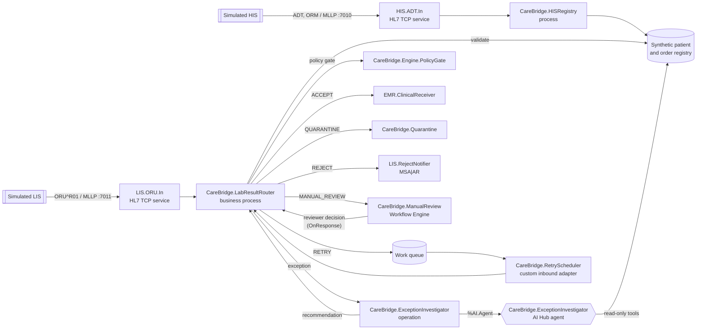
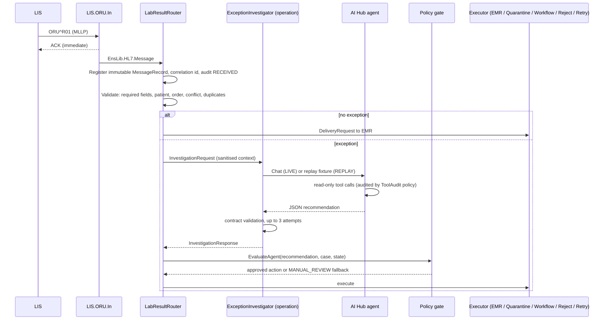

# Architecture

CareBridge AI is one IRIS for Health namespace (`CAREBRIDGE`) running one interoperability production, `CareBridge.Production`. Everything that receives, decides or acts is a production component; the dashboard only reads persisted state and submits review decisions.

## Systems

| Simulated system | How it talks to CareBridge | Production item |
|---|---|---|
| Hospital Information System (HIS) | HL7 v2 ADT^A04 / ORM^O01 over MLLP, port 7010 | `HIS.ADT.In` (EnsLib.HL7.Service.TCPService) → `CareBridge.HISRegistry` |
| Laboratory Information System (LIS) | HL7 v2 ORU^R01 over MLLP, port 7011; receives reject ACKs | `LIS.ORU.In` (EnsLib.HL7.Service.TCPService), `LIS.RejectNotifier` |
| Downstream clinical record receiver (EMR) | Receives accepted results unchanged | `EMR.ClinicalReceiver` |

## Production

## One message, end to end

## Components

| Class | Kind | Responsibility |
|---|---|---|
| `CareBridge.Process.LabResultRouter` | Business process | Orchestration, audit, execution of approved actions, Workflow round trip |
| `CareBridge.Process.HISRegistry` | Business process | Applies HIS ADT and ORM messages to the registry |
| `CareBridge.Operation.ExceptionInvestigator` | Business operation | Runs the agent (LIVE) or replay adapter (REPLAY); persists the AgentRun |
| `CareBridge.ExceptionInvestigator` | `%AI.Agent` | The AI Hub agent: instructions, provider from environment, toolset |
| `CareBridge.AI.InvestigationToolSet` / `InvestigationTools` | `%AI.ToolSet` / `%AI.Tool` | Six read-only tools |
| `CareBridge.AI.ToolAudit` | `%AI.Policy.Audit` | Persists every tool call |
| `CareBridge.AI.ToolGuard` | `%AI.Policy.Authorization` | Allowlist; denies and records anything else |
| `CareBridge.Engine.Validator` | Class | Deterministic findings and primary exception type |
| `CareBridge.Engine.Recommendation` | Class | Output contract and strict validator |
| `CareBridge.Engine.PolicyGate` | Class | Authoritative decision; persists every evaluation |
| `CareBridge.Engine.ReplayAgent` | Class | Deterministic agent adapter for REPLAY mode |
| `CareBridge.Operation.ClinicalReceiver` | Business operation | Simulated EMR; idempotent; can simulate outages |
| `CareBridge.Operation.QuarantineStore` | Business operation | Quarantine queue (+ file copy) |
| `CareBridge.Operation.RejectNotifier` | Business operation | MSA\|AR reject ACK for the LIS |
| `EnsLib.Workflow.Operation` (`CareBridge.ManualReview`) | Business operation | Hands review tasks to the reviewer role |
| `CareBridge.Adapter.DueWorkInboundAdapter` + `CareBridge.Service.RetryScheduler` | Adapter + service | Dispatches due retries |
| `CareBridge.API.REST` | `%CSP.REST` | Dashboard API |

## Persistence

All state is IRIS persistent classes in `CareBridge.Data`:

- `MessageRecord`: one per inbound result. `RawMessage` cannot be changed after the first save. It has a unique correlation id, an idempotency key (sender + control id) and a content hash.
- `ExceptionCase`: one per exception raised, holding its findings, context, status and resolution.
- `AgentRun` and `ToolCall`: the agent trace (see [observability.md](observability.md)).
- `PolicyEvaluation`: every verdict, agent or human, with every rule result.
- `AuditEvent`: append-only. Updates are refused, and deletes are refused except during an explicit demo reset.
- `DeliveredResult`: the EMR's inbox. Unique indexes on correlation id and content hash make a second copy impossible at the database level.
- `QueueItem`: quarantine, review, retry and reject-notice items.
- `Patient` and `LabOrder`: the synthetic HIS registry.

## Safety boundaries

- The agent's tools can only read. Their arguments are identifiers, and they return small JSON documents. No tool accepts SQL text, a file path or a command.
- `ToolGuard` denies any tool outside the allowlist.
- Model output must match the contract; anything else counts as no recommendation.
- The policy gate decides. When there is no valid, grounded, permitted recommendation, the result goes to manual review.
- Human decisions pass through the same gate, re-checked against the current state.
